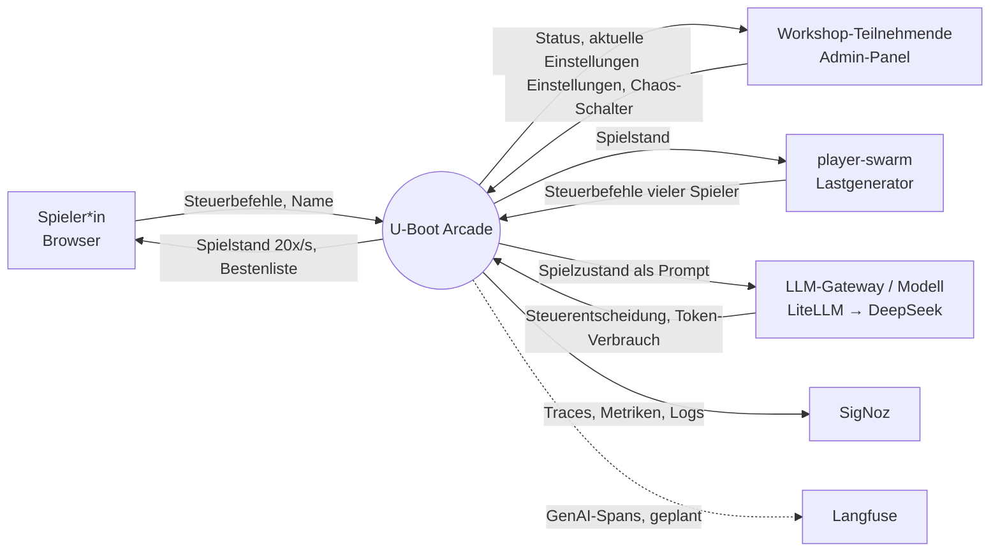

# Fachlicher Kontext

Systemgrenze: die U-Boot-Arcade-Services (game-server, physics, enemy-ai, leaderboard) samt Leaderboard-Datenbank.
Der Lastgenerator `player-swarm` gehört zum Repository, tritt fachlich aber wie ein Spieler von außen auf.

## Kontextdiagramm

## Kommunikationspartner

| Partner | Eingabe (an System) | Ausgabe (vom System) | Beschreibung | Status |
|---------|---------------------|---------------------|-------------|--------|
| Spieler*in (Browser) | Beitritt mit Name, Steuerung (Fahrt, Tauchen, Torpedo), Ping | Spielstand pro Tick, eigene Boot-ID, Pong, Bestenliste | Spielt über `index.html` | umgesetzt |
| Workshop-Teilnehmende (Admin) | Anzahl Bots/Gegner, LLM an/aus, Chaos-Schalter | Status (Tick, Clients, Boote), aktuelle Einstellungen | Über `admin.html`; ohne Anmeldung | umgesetzt |
| player-swarm | Wie Spieler*in, viele Clients parallel | Spielstand | Erzeugt WebSocket-Last und Client-Metriken (`game.client.rtt`, `swarm.state.interval`) | umgesetzt |
| LLM über LiteLLM | Antwort mit Steuerbefehl und Begründung, Token-Verbrauch | Systemprompt und Spielzustand aus Sicht eines Gegners | Steuert Gegner, wenn „LLM für Gegner“ aktiv; sonst regelbasierter Fallback | umgesetzt (LiteLLM des Workshop-Clusters, `eu.deepseek-v4.1-flash`, ADR-15; kein lokales Modell, ADR-14) |
| SigNoz | – | Traces, Metriken, Logs (inkl. fachlicher Werte und Events) | Lokal im Telemetrie-Compose oder gehostet vom Veranstalter; optional – ohne Telemetrie-Ziel läuft das Spiel ebenso (ADR-10) | umgesetzt (OTLP direkt oder lokal über Gateway-Collector) |
| Langfuse | – | GenAI-Spans mit Prompt, Completion, Session, Kosten | Analyse der LLM-Aufrufe | **geplant** (Collector-Fan-out, Langfuse-Attribute) |
| Jev (TypeSafe „System One“) | Entscheidung mit Konfidenz | Spielzustand und Fragen | Optionale dritte Gegner-KI-Variante, nur bei Zugang | **geplant, optional** |

<!-- ABGELEITET: Aus Code erkannt, bitte verifizieren -->
