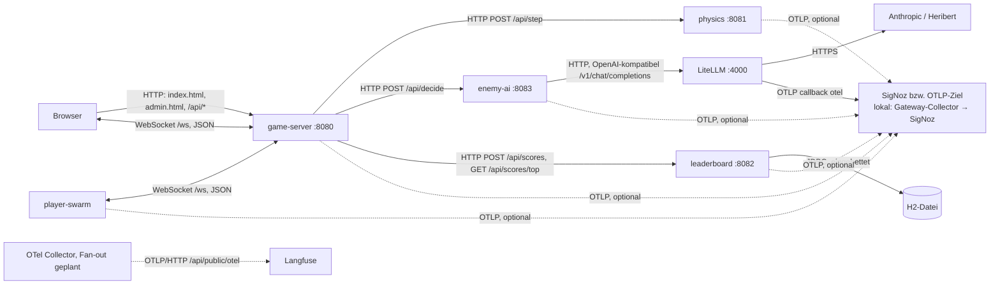

# Technischer Kontext

## Technisches Kontextdiagramm

Innerhalb der Systemgrenze (game-server, physics, enemy-ai, leaderboard, DB) sind die Schnittstellen hier nur zur
Orientierung gezeigt; Details in [Kapitel 5](../05-Bausteinsicht/).

## Kanal-Zuordnung

| Partner | Kanal/Protokoll | Datenformat | Authentifizierung | Bemerkung |
|---------|----------------|-------------|-------------------|-----------|
| Browser (Spiel) | WebSocket `/ws` am game-server; Nachrichten `join`, `input`, `ping` → `welcome`, Zustand, `pong` | JSON | keine; alle Origins erlaubt | Lokal Port 8088 (`PORT`/`GAME_PORT`) |
| Browser (Admin) | HTTP `GET/PUT /api/admin/settings`, `GET /api/status`, `GET /api/leaderboard` | JSON | keine | Admin-API ungeschützt, für Workshop-Zwecke <!-- TODO: Bitte ergänzen (bewusst so?) --> |
| player-swarm | WebSocket `GAME_WS_URL` | JSON | keine | Anzahl über `SWARM_PLAYERS` |
| LiteLLM / LLM | HTTP, OpenAI-kompatibel, `LLM_BASE_URL` (Default `http://localhost:4000/v1`, Helm `llm.baseUrl`), Modell `LLM_MODEL` (`enemy-brain`) | JSON | Bearer `LLM_API_KEY`; Anbieter-Keys (z. B. `ANTHROPIC_API_KEY`) nur in LiteLLM | Timeout `LLM_TIMEOUT_MS` (4 s), `LLM_MAX_TOKENS` (60) |
| SigNoz / OTLP-Ziel (optional, je nach Telemetrie-Betriebsart, ADR-10) | OTLP gRPC :4317 per `OTEL_EXPORTER_OTLP_PROTOCOL=grpc` (Agent-Default ist http/protobuf :4318), `OTEL_EXPORTER_OTLP_ENDPOINT`; Export-Schalter `OTEL_*_EXPORTER` | OTLP/Protobuf | `OTEL_EXPORTER_OTLP_HEADERS` (z. B. `signoz-ingestion-key`) | Sampling über `OTEL_TRACES_SAMPLER(_ARG)` |
| Langfuse | OTLP **nur HTTP**, `https://<host>/api/public/otel` | OTLP/Protobuf oder JSON | Basic `base64(pk-lf-…:sk-lf-…)`, `x-langfuse-ingestion-version=4` | **geplant** über den lokalen OTel Collector (`deploy/telemetry`, ADR-09) |
| H2 (eingebettet) | JDBC `DB_URL` (Default `jdbc:h2:file:./data/leaderboard`) | SQL | keine (Default-Benutzer `sa`) | Läuft im Leaderboard-Prozess, innerhalb der Systemgrenze |

<!-- ABGELEITET: Aus Code erkannt, bitte verifizieren -->

## Mapping fachlich → technisch

| Fachliche Schnittstelle | Technische Realisierung |
|------------------------|------------------------|
| Spielen | WebSocket `/ws` (JSON), statisches Frontend vom game-server |
| Einstellungen und Chaos ändern | `PUT /api/admin/settings` (`GameSettings` inkl. `Chaos`), wird an die Services durchgereicht (physics und enemy-ai im Request-Body, leaderboard als Header `X-Chaos-Slow-Ms`) |
| Bestenliste ansehen | `GET /api/leaderboard` → leaderboard `GET /api/scores/top?limit=10` → SQL |
| Gegner-Entscheidung per LLM | enemy-ai → `POST {LLM_BASE_URL}/chat/completions`, Span `chat <model>` |
| Telemetrie liefern | OTel-Java-Agent + OTel-API → OTLP an `OTEL_EXPORTER_OTLP_ENDPOINT` |
