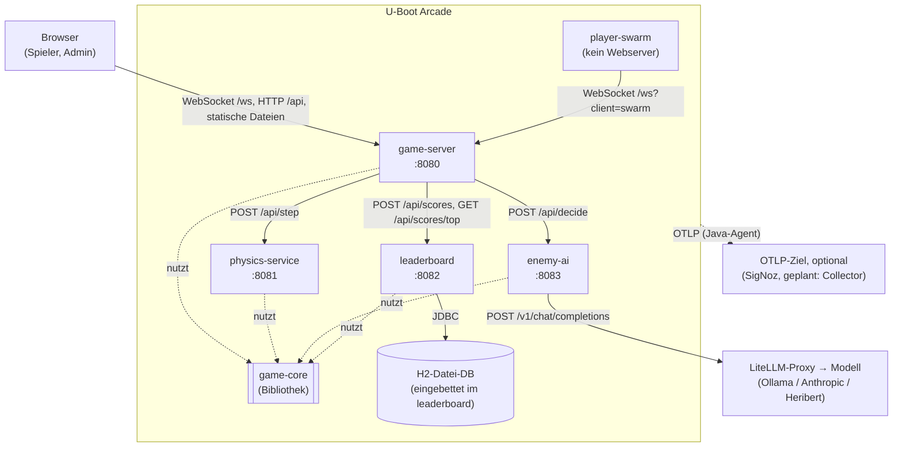

# Bausteinsicht — Ebene 1

<!-- ABGELEITET: Aus Code erkannt (settings.gradle.kts, Modul-Quellen, application.yaml), bitte verifizieren -->

## Whitebox Gesamtsystem

### Übersichtsdiagramm

### Motivation

- **Beobachtbarkeit als Zweck:** Die Zerlegung in mehrere Services ist bewusst so gewählt, dass jeder Spiel-Tick
  verteilte Traces über HTTP-Grenzen erzeugt (Game-Server → Physik, → Gegner-KI → LLM, → Leaderboard → DB).
  Ein Monolith würde für den Observability-Workshop deutlich weniger zeigen.
- **Zustand nur an einer Stelle:** Der Spielstand liegt ausschließlich im Speicher des `game-server`. `physics-service`
  und `enemy-ai` sind zustandslos (bekommen die ganze Welt pro Request) und lassen sich daher horizontal skalieren.
- **Gemeinsame, framework-freie Logik:** Modell, Physik, regelbasierte KI und LLM-Protokoll liegen in `game-core` und
  sind ohne Spring/OTel testbar. Die Services sind dünne Spring-Boot-Hüllen darum.
- **Störbarkeit:** Jede Grenze ist ein Ansatzpunkt für Chaos (Latenz, Fehler, langsame DB, LLM-Runaway).

<!-- TODO: Bitte ergänzen – ggf. weitere Gründe für den Schnitt (z. B. Workshop-Übungen pro Service) -->

### Enthaltene Bausteine

| Baustein | Verantwortlichkeit | Schnittstellen |
|----------|-------------------|----------------|
| `game-core` | Reine Spiellogik ohne Frameworks: Datenmodell (`World`, `Sub`, `Torpedo`, `Controls`, `Chaos`), `PhysicsEngine`, regelbasierte KI `BotBrain`, Prompt-Bau/Parsing `LlmProtocol`, DTOs zwischen den Services | Kotlin-API (Bibliothek, kein Prozess) |
| `game-server` | Tick-Schleife (20 Ticks/s), hält den Spielstand, verwaltet Spieler/Bots/Gegner, verteilt den Spielstand per WebSocket, Admin-API, liefert das Frontend aus | WebSocket `/ws`; `GET/PUT /api/admin/settings`, `GET /api/status`, `GET /api/leaderboard`; statisch `index.html`, `admin.html`, `game.js` |
| `physics-service` | Berechnet zustandslos den nächsten Weltzustand aus Welt + Steuerbefehlen; injiziert Physik-Chaos (Latenz, 503-Fehler) | `POST /api/step` (`StepRequest` → `StepResponse`) |
| `enemy-ai` | Entscheidet die Steuerung eines Gegner-U-Boots, per LLM (OpenAI-kompatibel) oder regelbasiert als Fallback; GenAI-Telemetrie | `POST /api/decide` (`DecideRequest` → `DecideResponse`); ausgehend `POST {LLM_BASE_URL}/chat/completions` |
| `leaderboard` | Speichert das Ergebnis jeder Runde und liefert eine Rangliste | `POST /api/scores` (Header `X-Chaos-Slow-Ms`), `GET /api/scores/top?limit=` ; JDBC |
| `player-swarm` | Lastgenerator: startet N simulierte Spieler als echte WebSocket-Clients mit Zufallssteuerung, misst RTT und Update-Abstände | WebSocket-Client gegen `GAME_WS_URL` |
| Frontend (Teil von `game-server`) | Spielansicht (Canvas, Tastatur) in zwei Darstellungsvarianten (U-Boot, Slop), Leaderboard-Anzeige, Admin-Panel mit Chaos-Schaltern | nutzt `/ws` und `/api/*` |
| Datenbank | Tabelle `scores` | H2, eingebettet im Leaderboard-Prozess (Datei-DB) |

### game-core (Blackbox)

**Zweck/Verantwortlichkeit:** Gemeinsame Domänenlogik und Datenverträge aller Services. Bleibt laut `AGENTS.md`
frei von Spring und OpenTelemetry. Einzige Komponente mit Unit-Tests (16 Tests).

**Schnittstellen:**
- `PhysicsEngine.step(StepRequest): StepResponse`, `PhysicsEngine.spawn(...)`
- `BotBrain.decide(self, world): Controls`
- `LlmProtocol.SYSTEM_PROMPT`, `userPrompt(self, world)`, `parseControls(text)`
- DTOs: `StepRequest/Response`, `DecideRequest/Response`, `ScoreEntry`, `Chaos`, `GameEvent`/`EventType`

**Code-Location:** `game-core/src/main/kotlin/io/github/ckaiser/uboot/core/`

### game-server (Blackbox)

**Zweck/Verantwortlichkeit:** Einziger zustandsbehafteter Baustein und Taktgeber des Spiels. Verfeinert in
[05-02-Ebene-2-Game-Server](05-02-Ebene-2-Game-Server.md).

**Schnittstellen:**
- WebSocket `/ws` (JSON): Client → Server `join`, `input`, `ping`, `rtt`; Server → Client `welcome`, `state`, `pong`
- REST: `GET/PUT /api/admin/settings` (Bots, Gegner, LLM an/aus, Chaos), `GET /api/status`, `GET /api/leaderboard` (Durchreichen an `leaderboard`)
- Ausgehend: HTTP-Clients zu `physics-service` (Read-Timeout 2 s), `enemy-ai` (90 s), `leaderboard` (10 s)
- Konfiguration: `PORT`, `PHYSICS_URL`, `ENEMY_AI_URL`, `LEADERBOARD_URL`, `GAME_TICK_MILLIS`, `GAME_BOTS`, `GAME_ENEMIES`, `GAME_LLM_ENABLED`, `GAME_ENEMY_DECISION_EVERY_TICKS`

**Code-Location:** `game-server/src/main/kotlin/io/github/ckaiser/uboot/game/`, Frontend unter `game-server/src/main/resources/static/`

### physics-service (Blackbox)

**Zweck/Verantwortlichkeit:** Zustandslose Simulation eines Zeitschritts mit `PhysicsEngine`. Wertet die Chaos-Felder
`physicsLatencyMs` (Span `chaos latency`) und `physicsErrorRate` (HTTP 503) aus dem Request aus.

**Schnittstellen:** `POST /api/step`; Metriken `physics.events`, `physics.step.entities`, `chaos.injected`

**Code-Location:** `physics-service/src/main/kotlin/io/github/ckaiser/uboot/physics/`

### enemy-ai (Blackbox)

**Zweck/Verantwortlichkeit:** Gegner-Entscheidung per LLM mit Fallback auf `BotBrain`. Verfeinert in
[05-03-Ebene-2-Enemy-AI](05-03-Ebene-2-Enemy-AI.md).

**Schnittstellen:** `POST /api/decide`; ausgehend OpenAI-kompatibles Chat-Completions-API (typisch LiteLLM, Modellalias `enemy-brain`);
Konfiguration `LLM_BASE_URL`, `LLM_MODEL`, `LLM_API_KEY`, `LLM_TIMEOUT_MS`, `LLM_MAX_TOKENS`, `LLM_PRICE_*_PER_MTOK`

**Code-Location:** `enemy-ai/src/main/kotlin/io/github/ckaiser/uboot/enemy/`

### leaderboard (Blackbox)

**Zweck/Verantwortlichkeit:** Persistiert Rundenergebnisse (`scores`: Name, Typ, Punkte, Abschüsse, Ursache) und
aggregiert die Top-Liste (bester Wert, Summe Abschüsse, Anzahl Runden). Chaos „Leaderboard langsam“ über `Thread.sleep`
vor dem Insert. Die Datenbank ist eine eingebettete H2-Datei-DB (ADR-07).

**Schnittstellen:** `POST /api/scores`, `GET /api/scores/top`; JDBC (`DB_URL`, Default `jdbc:h2:file:./data/leaderboard`; `DB_USER`/`DB_PASSWORD` optional); Schema in `schema.sql`

**Code-Location:** `leaderboard/src/main/kotlin/io/github/ckaiser/uboot/leaderboard/`, `leaderboard/src/main/resources/schema.sql`

**Einschränkung:** Nur eine Instanz, denn jede Instanz hätte ihre eigene H2-Datei.

### player-swarm (Blackbox)

**Zweck/Verantwortlichkeit:** Erzeugt WebSocket-Last (Standard 5, mit `.env.example` und im Helm-Chart 10 Spieler pro Prozess) mit Ramp-up,
sendet Steuerung alle 100 ms und Ping jede Sekunde, verbindet sich bei Fehlern neu.

**Schnittstellen:** WebSocket-Client; Konfiguration `GAME_WS_URL`, `SWARM_PLAYERS`, `SWARM_RAMP_UP_MS`, `SWARM_INPUT_INTERVAL_MS`, `SWARM_NAME_PREFIX`;
Metriken `swarm.rtt`, `swarm.state.interval`, `swarm.connects`, `swarm.players.connected`

**Code-Location:** `player-swarm/src/main/kotlin/io/github/ckaiser/uboot/swarm/`

### Querschnitt: Telemetrie

Alle Spring-Services laufen mit dem OpenTelemetry-Java-Agent 2.32.0 (HTTP, JDBC, Logs, JVM automatisch). Eigene Spans
und Metriken entstehen über `opentelemetry-api` 1.66.0 via `GlobalOpenTelemetry`. Details in Kapitel 8.
<!-- TODO: Bitte ergänzen – Verweis auf das Telemetrie-Konzept in Kapitel 8, sobald vorhanden -->
