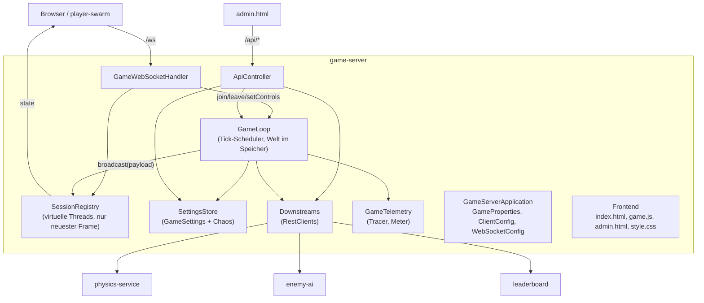

# Bausteinsicht — Ebene 2: game-server

<!-- ABGELEITET: Aus Code erkannt (game-server/src/main/kotlin/io/github/ckaiser/uboot/game/*.kt, static/*), bitte verifizieren -->

## Whitebox game-server

### Übersichtsdiagramm

### Motivation

- `GameLoop` bündelt allen Spielzustand und alle Downstream-Aufrufe; die Welt wird pro Tick als unveränderliches
  `World`-Objekt ersetzt (`@Volatile`), Eingaben werden über nebenläufige Queues/Maps entkoppelt.
- `SessionRegistry` ist bewusst vom Handler getrennt, damit sich `GameLoop` und `GameWebSocketHandler` nicht zyklisch brauchen.
- Langsame Downstreams dürfen den Tick nicht blockieren: Gegner-KI und Leaderboard werden asynchron in eigenen
  Thread-Pools aufgerufen; nur der Physik-Aufruf ist synchron im Tick.
- Langsame Clients dürfen den Tick nicht blockieren: Senden pro Client in virtuellen Threads, ältere Frames werden verworfen.

### Enthaltene Bausteine

| Sub-Baustein | Verantwortlichkeit |
|-------------|-------------------|
| `GameLoop` | Single-Thread-Scheduler (`game-tick`, Intervall `tickMillis` = 50 ms). Pro Tick: Roster abgleichen (Join/Leave, Anzahl Bots/Gegner), alle `enemyDecisionEveryTicks` (20) Gegner-Entscheidungen anstoßen, Bot-Steuerung lokal mit `BotBrain`, Physik synchron aufrufen, Ereignisse auswerten (Logs, Score bei `DESTROYED`), Broadcast, Chaos „Memory Leak“ (64 KB pro Tick). Bei Physik-Ausfall bleibt die Welt unverändert („friert ein“). |
| Gegner-Executor | Fester Pool mit 4 Threads; max. eine laufende Anfrage je Gegner (`enemyInFlight`). Antwort wirkt erst in einem späteren Tick (`enemyControls`). |
| Leaderboard-Executor | 2 Threads, Queue 200, `AbortPolicy`: bei voller Queue wird verworfen (`game.leaderboard.dropped`, `reason=queue_full`). |
| `SessionRegistry` | Verbundene Clients (`browser`/`swarm`), `ConcurrentWebSocketSessionDecorator` (2 s Send-Timeout, 1 MB Puffer), pro Client ein `pending`-Slot mit nur dem neuesten Spielstand; Drain über `newVirtualThreadPerTaskExecutor`. Überschriebene Frames → `game.websocket.frames_dropped`. |
| `GameWebSocketHandler` | WebSocket-Protokoll: `join` → `GameLoop.join` + `welcome{id}`; `input` → `setControls`; `ping` → `pong`; `rtt` → Metrik `game.client.rtt`. Verbindungsende → `GameLoop.leave`. |
| `ApiController` | Admin-API `GET/PUT /api/admin/settings`, `GET /api/status`, `GET /api/leaderboard` (Proxy auf `leaderboard`, bei Fehler 502 + leere Liste). |
| `SettingsStore` / `GameSettings` | Zur Laufzeit änderbare Einstellungen (Bots 0–60, Gegner 0–5, LLM an/aus, `Chaos`) mit Wertebegrenzung (`sanitized`, z. B. Physik-Latenz ≤ 1500 ms unter dem 2-s-Timeout). Nur im Speicher. |
| `Downstreams` / `ClientConfig` | Drei `RestClient`s auf JDK-`HttpClient` mit Connect-Timeout 2 s und Read-Timeouts 2 s (Physik), 90 s (Gegner-KI, wegen Runaway), 10 s (Leaderboard). |
| `GameTelemetry` | Tracer/Meter `u-boot-arcade.game-server`; Metriken wie `game.tick.duration`, `game.tick.overruns`, `game.physics.failures`, `game.events`, `game.enemy.decision.latency`, `game.state.size`; Observable Gauges pro Boot (`sub.depth`, `sub.boiler.pressure`, …). |
| Frontend (`static/`) | `index.html` + `game.js`: Canvas-Rendering, Eingabe alle 50 ms, Ping jede Sekunde, Reconnect nach 2 s, Leaderboard-Abruf alle 5 s. `admin.html`: Schieberegler/Checkboxen für Einstellungen und Chaos, Statusanzeige. |

### Offene Punkte

- Admin-API und Admin-Panel haben keine Authentifizierung. <!-- TODO: Bitte ergänzen – bewusst so für den Workshop? -->
- Zielbild Chaos pro U-Boot auf einer Skala: Ablage der Einstellungen (heute global in `GameSettings.chaos`) noch offen. <!-- TODO: Bitte ergänzen -->
