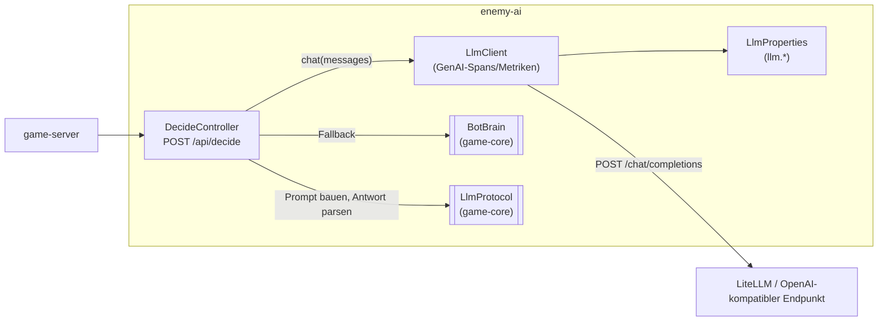

# Bausteinsicht — Ebene 2: enemy-ai

<!-- ABGELEITET: Aus Code erkannt (enemy-ai/src/main/kotlin/io/github/ckaiser/uboot/enemy/*.kt, application.yaml, deploy/litellm-config.yaml), bitte verifizieren -->

## Whitebox enemy-ai

### Übersichtsdiagramm

### Motivation

- Die Gegner-KI ist ein eigener Service, damit LLM-Aufrufe (langsam, teuer, fehleranfällig) als eigene Traces mit
  GenAI-Semantik sichtbar werden und den Game-Server nicht belasten.
- Fallback auf die regelbasierte `BotBrain` hält das Spiel auch ohne LLM spielbar; die Ursache steht im
  `outcome` der Antwort und in der Metrik `enemy_ai.decisions`.
- `LlmClient` spricht nur das OpenAI-kompatible Chat-Completions-Format. Welches Modell dahinter steckt, entscheidet
  LiteLLM über den Alias (`enemy-brain` → Ollama `qwen2.5:3b`, `enemy-brain-cloud` → Anthropic `claude-haiku-4-5`).

### Enthaltene Bausteine

| Sub-Baustein | Verantwortlichkeit |
|-------------|-------------------|
| `DecideController` | Findet das eigene Boot in der Welt, setzt Span-Attribute (`enemy.id`, `enemy.name`, `enemy.llm_enabled`), wendet Chaos `aiLatencyMs` (Sleep) und `aiRunaway` (8 statt 1 LLM-Runde mit wachsendem Kontext) an. Ergebnis: `DecideResponse` mit `source` (`llm`/`fallback`) und `outcome` (`ok`, `disabled`, `timeout`, `connection_error`, `http_<code>`, `invalid_response`, `parse_error`, `unknown_enemy`). Metriken `enemy_ai.decisions`, `enemy_ai.llm.calls_per_decision`. |
| `LlmClient` | Minimaler HTTP-Client (JDK `HttpClient`, Connect 2 s, Request-Timeout `LLM_TIMEOUT_MS`). Span `chat <model>` (Kind CLIENT) mit `gen_ai.operation.name`, `gen_ai.provider.name=openai`, `gen_ai.request.model`, `gen_ai.response.model`, `gen_ai.usage.input_tokens/output_tokens`, `gen_ai.response.finish_reasons`, `enemy_ai.llm.cost_usd`. Metriken `gen_ai.client.token.usage`, `gen_ai.client.operation.duration`, `enemy_ai.llm.cost` (aus konfigurierten Preisen). Fehler werden als `LlmException(errorType)` gemeldet. |
| `LlmProperties` | `llm.base-url`, `model`, `api-key`, `timeout-ms` (4000, Helm 8000), `max-tokens` (60), `price-input/output-per-mtok` (3.0 / 15.0 USD). |
| `BotBrain` (aus `game-core`) | Regelbasierte Fallback-Entscheidung. |
| `LlmProtocol` (aus `game-core`) | System-Prompt (Spielregeln, Antwort nur als JSON `throttle`/`dive`/`fire`), User-Prompt aus Lage, toleranter Parser. |

### Geplant

- **Langfuse-Tauglichkeit:** `gen_ai.prompt`/`gen_ai.completion` bzw. `langfuse.observation.input/output`,
  `langfuse.session.id` pro Spielrunde/Gegner und `gen_ai.usage.cost` am Span setzen – heute nicht umgesetzt.
- **Kosten-Bremse:** Entscheidungsintervall bei LLM-Betrieb 5–10 s (heute alle 20 Ticks ≈ 1 s, gesteuert vom
  `game-server`), Runaway bei Cloud-Modellen deckeln, LiteLLM `max_budget`.
- **Modelle:** Anthropic (kleines Modell) und Heribert in `deploy/litellm-config.yaml`. <!-- TODO: Bitte ergänzen – Art des Heribert-Endpunkts -->
- **Optional Jev (TypeSafe „System One“)** als dritte Variante (regelbasiert / LLM / Jev), nur bei Zugang.
