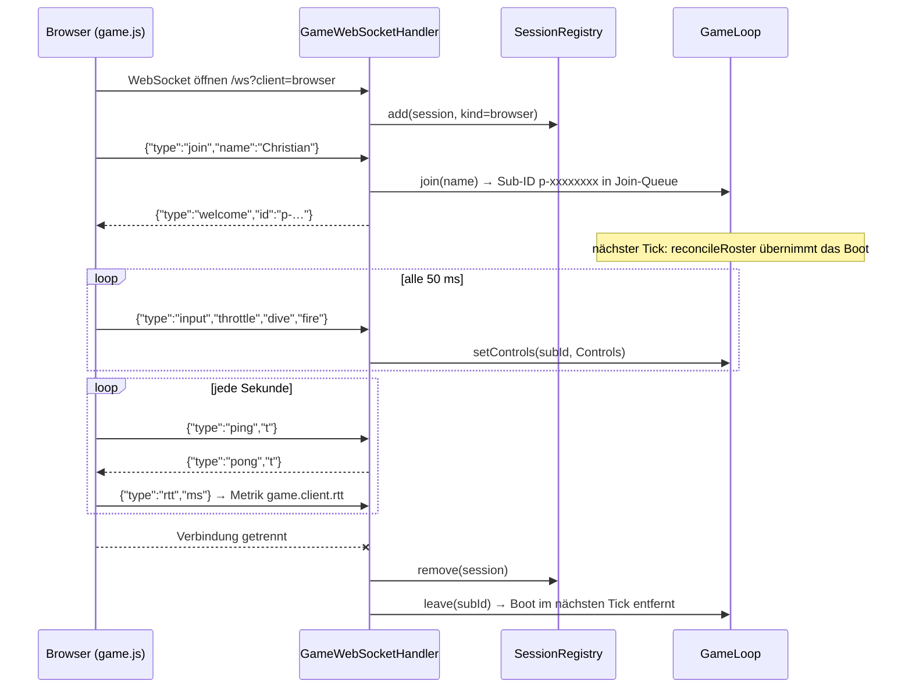
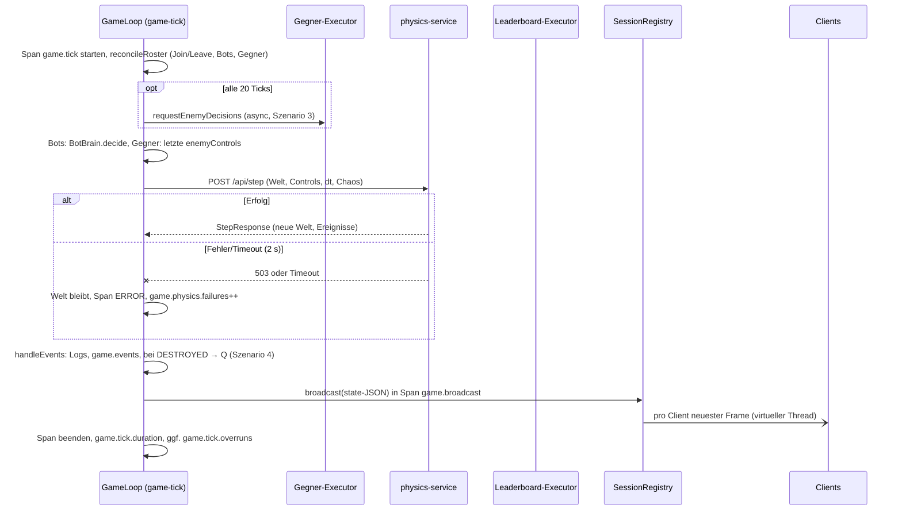
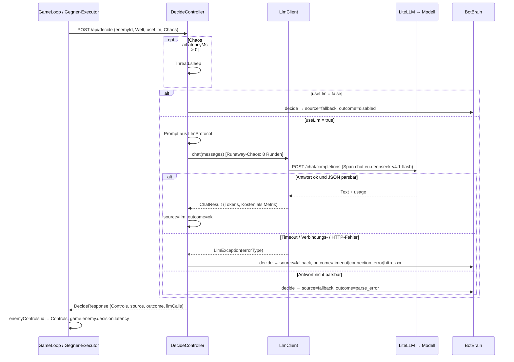
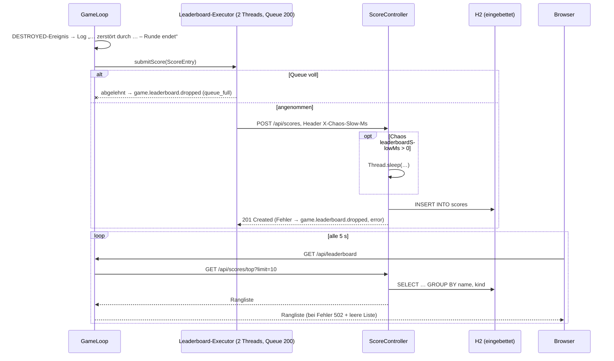

# Laufzeitsicht

<!-- ABGELEITET: Aus Code erkannt (GameLoop, GameWebSocketHandler, SessionRegistry, DecideController, LlmClient, ScoreController, PhysicsApplication, game.js), bitte verifizieren -->

Die Szenarien verwenden die Bausteine aus Kapitel 5. Beschrieben ist der **umgesetzte** Stand; Geplantes ist markiert.

## Szenario 1: Spieler verbindet sich per WebSocket

### Beschreibung

Ein Browser (oder ein `player-swarm`-Spieler) öffnet `/ws`, tritt mit einem Namen bei und erhält ab dann pro Tick
den Spielstand. Das Boot erscheint erst im nächsten Tick in der Welt.

### Ablauf

### Besonderheiten

- Der Client-Typ (`browser`/`swarm`) kommt aus dem Query-Parameter und wird als `client.kind` an Metriken gehängt.
- Spielstände erhält nur ein Client mit `subId` (also nach `join`). Zuschauer ohne Beitritt bekommen keine `state`-Nachrichten.
- `game.js` verbindet sich nach Abbruch nach 2 s neu und sendet `join` erneut (neues Boot, Punkte der Runde verloren).
- Es gibt keine Authentifizierung; Name wird auf 16 Zeichen gekürzt.

---

## Szenario 2: Ein Spiel-Tick

### Beschreibung

Der `game-tick`-Thread führt alle 50 ms einen Tick aus. Jeder Tick ist ein eigener Trace `game.tick` (ohne Parent).
Synchron ist nur der Physik-Aufruf; Gegner-KI und Leaderboard laufen asynchron, der Broadcast wird an virtuelle Threads abgegeben.

### Ablauf

### Besonderheiten

- `scheduleAtFixedRate` mit einem Thread: dauert ein Tick länger als 50 ms, verschieben sich Folgeticks (Overrun, Ruckeln).
- Ausnahmen im Tick werden geloggt; die Schleife läuft weiter (`safeTick`).
- Hat ein Client den letzten Frame noch nicht abgenommen, wird er überschrieben (`game.websocket.frames_dropped`).
- 20 Ticks/s erzeugen 20 Traces/s; Sampling ist über `OTEL_TRACES_SAMPLER` konfigurierbar (Standard: `parentbased_always_on`).

---

## Szenario 3: Gegner-Entscheidung mit LLM und Fallback

### Beschreibung

Alle `GAME_ENEMY_DECISION_EVERY_TICKS` (Standard 20 ≈ 1 s) fragt der Game-Server für jeden lebenden Gegner
asynchron die `enemy-ai`. Pro Gegner läuft höchstens eine Anfrage. Die Antwort gilt ab dem nächsten Tick.

### Ablauf

### Besonderheiten

- Ist `enemy-ai` nicht erreichbar, behält der Gegner seine letzte Steuerung (`outcome=unreachable` im Game-Server).
- Trace-Kontext wird vom `game.tick` in den Executor übernommen (`Context.wrap`); `traceparent` geht bis LiteLLM.
- Timeouts: LLM `LLM_TIMEOUT_MS` (4 s, Helm 8 s) je Aufruf, Game-Server → enemy-ai 90 s.
- **Geplant:** Deckelung des Runaway-Chaos, Langfuse-Attribute (Prompt/Completion, Session-ID).

---

## Szenario 4: Runde endet → Leaderboard

### Beschreibung

Wird ein Boot zerstört (Torpedo, Zerstörungstiefe, Überhitzung, …), meldet die Physik ein `DESTROYED`-Ereignis.
Der Game-Server trägt die Runde asynchron ins Leaderboard ein; die Anzeige im Browser fragt alle 5 s die Rangliste ab.

### Ablauf

### Besonderheiten

- Betrifft alle Bootstypen (Spieler, Bots, Gegner); jedes Leben ist eine Runde.
- Die Chaos-Verzögerung liegt im Leaderboard-Prozess vor dem Insert: Im Trace wird der HTTP-Span `POST /api/scores`
  lang, nicht der DB-Span. Variante mit echtem DB-Span siehe [IDEEN.md](../../IDEEN.md).

---

## Szenario 5: Chaos „Physik-Fehlerrate“ und „Physik-Latenz“

### Beschreibung

Im Admin-Panel werden Chaos-Schalter gesetzt. Sie gelten heute **global für alle Boote** und werden mit jedem
Request an die Downstream-Services weitergereicht (im Body bzw. bei Leaderboard als Header).

### Ablauf

1. Admin setzt in `admin.html` „Physik-Fehlerrate“ auf z. B. 0,3 → `PUT /api/admin/settings`.
2. `SettingsStore` begrenzt die Werte (`sanitized`) und loggt die Änderung „Einstellungen geändert: …“.
3. Im nächsten Tick sendet `GameLoop` das `Chaos`-Objekt im `StepRequest` mit; die Clients sehen es in `chaosActive`.
4. `physics-service` wirft bei ~30 % der Steps HTTP 503 (Span-Status ERROR, Metrik `chaos.injected{chaos.kind=physics_error}`, Warn-Log).
5. `GameLoop` zählt `game.physics.failures`, markiert `game.tick` als Fehler; die Welt bleibt in diesem Tick stehen (`physicsOk=false`).
6. Bei „Physik-Latenz“ entsteht stattdessen ein Span `chaos latency` (max. 1500 ms, im Panel bis 500 ms); `game.tick.duration` steigt, `game.tick.overruns` zählt, im Browser sinken Updates/s, beim Schwarm steigt `swarm.state.interval`.
7. Zurücksetzen im Panel beendet die Störung ab dem nächsten Tick.

### Besonderheiten

- Weitere Schalter wirken analog an anderer Stelle: KI-Latenz/Runaway in `enemy-ai`, Leaderboard langsam in `leaderboard`,
  Memory Leak im `game-server` (64 KB je Tick bis zum Abschalten), Kessel/Leck/Strömung in der Physik.
- **Zielbild (geplant):** Störung pro U-Boot auf einer Skala in der UI. Technische Umsetzung offen. <!-- TODO: Bitte ergänzen -->
