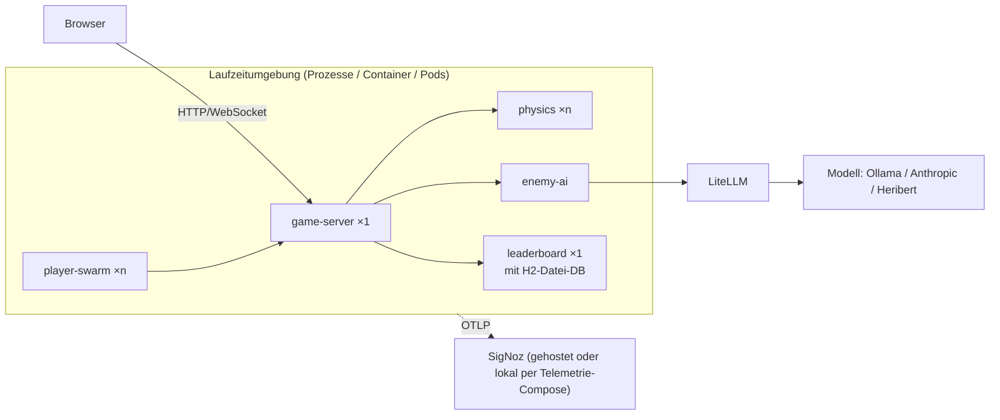

# Verteilungssicht

<!-- ABGELEITET: Aus Code erkannt (Dockerfile, run-local.sh, deploy/helm, deploy/litellm-config.yaml, README.md), bitte verifizieren -->

## Infrastruktur Ebene 1

Die Anwendung besteht aus fünf Spring-Boot-Prozessen (JDK 21, je ein Fat-JAR aus `./gradlew bootJar`) (das Leaderboard
mit eingebetteter H2-Datei-DB) und optional LiteLLM. Sie wird in zwei Varianten betrieben (ADR-11, kein Docker Compose für die Anwendung):

| Variante | Status | Zielumgebung | Details |
|----------|--------|--------------|---------|
| Lokal als JVM-Prozesse, ohne Docker (`run-local.sh`) | **umgesetzt** (Codespaces/Workshop noch nicht erprobt) | GitHub Codespaces (auch im Workshop), lokal (macOS/Linux), Sandbox | [07-02](07-02-Lokal-ohne-Docker.md) |
| Kubernetes per Helm | **umgesetzt** (nur mit eigenem Renderer geprüft, nicht mit `helm lint`) | Cluster neben SigNoz, ggf. der Kubernetes-Cluster des Workshops | [07-04](07-04-Kubernetes-Helm.md) |

Der Telemetrie-Fluss (heute und geplant mit Collector-Fan-out) steht in [07-05](07-05-Telemetrie-Fluss.md).

### Übersichtsdiagramm (variantenunabhängig)

### Motivation

- **Konfiguration nur über Umgebungsvariablen:** Der Code kennt keine Zieladressen (Downstream-URLs, DB, LLM, OTLP).
  So laufen dieselben Artefakte in allen Varianten.
- **Instrumentierung zur Laufzeit:** Der OTel-Java-Agent 2.32.0 wird per `-javaagent` geladen (im Image über
  `JAVA_TOOL_OPTIONS`, ohne Docker durch `run-local.sh`), nicht in die JARs eingebaut. Ob und wohin exportiert wird,
  ist reine Konfiguration (ADR-10).
- **Workshop ohne Docker:** Im Workshop gibt es nur einen Browser-VS-Code pro Person; deshalb ist der Start als
  JVM-Prozesse (in einem Codespace) die eigentliche Zielvariante. Helm dient für einen gemeinsamen Cluster, falls im Workshop
  einer genutzt wird.

### Qualitäts- und Performance-Merkmale

- **Skalierung:** `physics-service` ist zustandslos und horizontal skalierbar (Helm Standard 2 Replicas). `player-swarm`
  skaliert die Last über Replicas. `enemy-ai` ist zustandslos (Helm: 1 Replica).
- **Keine Redundanz des Game-Servers:** genau 1 Instanz, da der Spielstand im Speicher liegt; Neustart = Spielstand weg.
- **Persistenz:** nur das Leaderboard, als eingebettete H2-Datei-DB. Ohne Docker unter `./data/`, im Helm-Chart bewusst `emptyDir` (flüchtig). Deshalb genau 1 Leaderboard-Instanz.
- **Verfügbarkeit:** Für einen Workshop ausgelegt, keine Hochverfügbarkeit. <!-- TODO: Bitte ergänzen – Anforderungen an Betrieb während des Workshops -->

### Mapping Software → Infrastruktur

| Software-Baustein | Port | Lokal ohne Docker (`run-local.sh`) | Kubernetes (Helm) |
|------------------|------|-----------------------------------|-------------------|
| `game-server` | 8080 | JVM-Prozess auf `GAME_PORT` (8088, vermeidet Konflikt mit SigNoz-UI auf 8080) | Deployment 1 Replica, Strategie `Recreate`, Service Port 80, optional Ingress |
| `physics-service` | 8081 | JVM-Prozess | Deployment, 2 Replicas |
| `leaderboard` | 8082 | JVM-Prozess, H2-Datei unter `./data/` | Deployment 1 Replica, H2-Datei in `emptyDir` |
| `enemy-ai` | 8083 | JVM-Prozess | Deployment 1 Replica, API-Key aus Secret |
| `player-swarm` | – | JVM-Prozess (optional, `--swarm`) | Deployment, `playersPerPod` 10 |
| LiteLLM | 4000 | `pip install 'litellm[proxy]'` mit `deploy/litellm-config.yaml` (geplant) oder extern | nicht im Chart, `llm.baseUrl` zeigt auf externe Instanz |
| Modell | – | Ollama nativ (`qwen2.5:3b`), Anthropic / Heribert (Cloud) | extern |
| OTel Collector | 4317/4318 | `otelcol-contrib`-Binary (geplant) | – (SigNoz-Collector im Cluster) |
| OTel-Java-Agent | – | einmal nach `.otel/` heruntergeladen, per `-javaagent` | im Image `/otel/opentelemetry-javaagent.jar` |

### Knoten-Beschreibungen

#### Container-Image (alle Services)

- **Typ:** Ein gemeinsames Multi-Stage-`Dockerfile`, Build-Argument `SERVICE` wählt das Modul.
- **Build:** `eclipse-temurin:21-jdk`, `./gradlew :<SERVICE>:bootJar -x test`.
- **Laufzeit:** `eclipse-temurin:21-jre`, Nutzer UID 10001, `JAVA_TOOL_OPTIONS=-javaagent:… -XX:MaxRAMPercentage=75`.
- **Images:** für den Cluster `<registry>/u-boot-arcade-<komponente>:<tag>` über `deploy/build-images.sh`.
