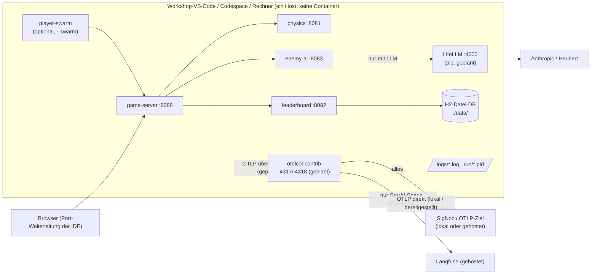

# Verteilungssicht — Lokal als JVM-Prozesse ohne Docker

> **Status:** `run-local.sh`/`stop-local.sh` sind umgesetzt (#3), lokal und in einer Linux-Sandbox geprüft.
> In GitHub Codespaces und im Workshop-VS-Code noch nicht erprobt. LiteLLM ohne Docker und der lokale Collector sind
> weiterhin **geplant**.

## Zielumgebungen

Workshop-VS-Code im Browser (pro Person, **kein Docker**), GitHub Codespaces, Sandbox, lokaler Rechner (macOS/Linux).
Voraussetzung ist nur ein JDK ≥ 21 und `curl`; der Gradle Wrapper lädt Gradle nach. In Codespaces wird das
Docker-in-Docker des Dev Containers dafür nicht gebraucht.
Netzzugriff auf `services.gradle.org`, `plugins.gradle.org`, Maven Central und GitHub-Releases (OTel-Agent) ist für den
ersten Start nötig.

## Übersichtsdiagramm

Ohne Telemetrie-Backend und mit regelbasiertem Gegner (`GAME_LLM_ENABLED=false`) braucht es nur die vier JVMs.

## Ablauf von `run-local.sh`

1. Konfiguration aus `.env` lesen (andere Datei per `ENV_FILE=…`); fehlt sie, Abbruch mit Hinweis auf `.env.example`.
2. Abbruch, wenn laut `.run/*.pid` noch Services laufen.
3. OTel-Java-Agent 2.32.0 einmalig nach `.otel/` herunterladen und wiederverwenden.
4. `./gradlew bootJar` für alle Services.
5. physics, leaderboard, enemy-ai mit `-javaagent`, `OTEL_SERVICE_NAME` und eigenem `PORT` im Hintergrund starten,
   auf `/actuator/health` warten; dann game-server (`PORT=$GAME_PORT`, Standard 8088) mit den Downstream-URLs;
   mit `--swarm` zusätzlich player-swarm. Logs nach `logs/<service>.log`, PIDs nach `.run/<service>.pid`.
6. Kommt ein Service nicht hoch (Prozess beendet oder `STARTUP_TIMEOUT`, Standard 120 s), zeigt das Skript die letzten
   Log-Zeilen und verweist auf `stop-local.sh`.

`stop-local.sh` sendet SIGTERM an alle Java-Prozesse aus `.run/`, wartet bis `STOP_TIMEOUT` (20 s), beendet
Übriggebliebene mit SIGKILL und räumt die PID-Dateien auf.

## Besonderheiten

- **Ohne Telemetrie-Backend:** Standard in `.env.example` ist `OTEL_*_EXPORTER=none` – der Agent instrumentiert, exportiert
  aber nichts, keine Fehler-Logs (ADR-10). Ist ein OTLP-Ziel gesetzt, aber nicht erreichbar, starten alle Services
  trotzdem ohne Verzögerung; der Agent loggt dann je Exportversuch einen Fehler.
- **Telemetrie-Ziel:** nur über `.env` (Telemetrie-Betriebsarten siehe [08-02](../08-Konzepte/08-02-Telemetrie.md)). Achtung:
  Der Agent nutzt ohne Angabe OTLP/HTTP auf 4318; für Port 4317 `OTEL_EXPORTER_OTLP_PROTOCOL=grpc` setzen.
- **Portkonflikt mit der SigNoz-UI (8080) gelöst:** Das Skript startet den Game-Server auf `GAME_PORT` (8088).
  Die übrigen Ports sind per `PHYSICS_PORT`, `LEADERBOARD_PORT`, `ENEMY_AI_PORT` änderbar.
- **Keine externe Datenbank:** Das Leaderboard legt seine H2-Datei unter `./data/` im Repo-Verzeichnis an (ADR-07).
- **Speicher:** `JAVA_OPTS` (Standard `-Xmx256m`) je JVM. In der Sandbox dauerte `run-local.sh` mit warmem
  Gradle-Cache rund 1–1,5 Minuten (je Service 20–30 s Startzeit mit Agent; physics, leaderboard und enemy-ai parallel,
  danach game-server).
- **LLM-Kosten:** Echte Cloud-Modelle kosten Geld – Entscheidungsintervall auf 5–10 s, Runaway deckeln, LiteLLM `max_budget` (geplant).
- **Lokal mit Docker für die Backends:** Läuft der Rechner mit Docker, können SigNoz und Langfuse dort in Containern
  laufen; die JVM-Prozesse exportieren an `localhost` (eigenes Compose geplant, #5).
- Ressourcen der Workshop-Umgebung. <!-- TODO: Bitte ergänzen – Speicher/CPU des Workshop-VS-Code -->
- OTLP-Adressen und Zugangsdaten der gehosteten Backends. <!-- TODO: Bitte ergänzen – vom Veranstalter noch nicht bekannt -->
