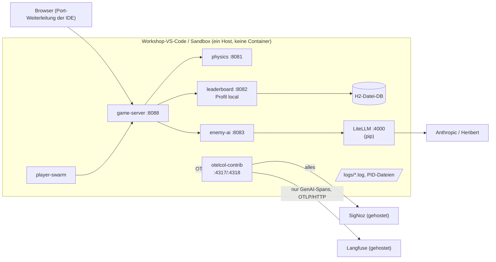

# Verteilungssicht — Lokal als JVM-Prozesse ohne Docker (geplant)

> **Status: geplant.** `run-local.sh`, `stop-local.sh` und die lokale Collector-Konfiguration existieren noch nicht.
> Das Leaderboard braucht keine externe Datenbank mehr (H2-Datei-DB, ADR-07). Bis dahin: Docker Compose ([07-03](07-03-Docker-Compose.md)).

<!-- ABGELEITET: Aus README.md und der früheren Projektbeschreibung (offene Aufgaben 2, 3, 5, 7), bitte verifizieren -->

## Zielumgebungen

Workshop-VS-Code im Browser (pro Person, **kein Docker**), GitHub Codespaces, Sandbox, lokaler Rechner.
Der Start ohne Docker muss mindestens **lokal** und **in GitHub Codespaces** funktionieren.
Voraussetzung ist nur ein JDK ≥ 21; der Gradle Wrapper lädt Gradle nach.
Netzzugriff auf `services.gradle.org`, `plugins.gradle.org` und Maven Central ist für den ersten Build nötig.

## Übersichtsdiagramm (Zielbild)

## Geplanter Ablauf von `run-local.sh`

1. Konfiguration aus `.env` lesen (OTLP-Ziel, Zugangsdaten, LLM, Ports).
2. OTel-Java-Agent 2.32.0 einmalig herunterladen und wiederverwenden.
3. `./gradlew bootJar` für alle Services.
4. Services mit `-javaagent`, `OTEL_SERVICE_NAME` und eigenem Port im Hintergrund starten; Logs nach `logs/`, PIDs merken.
5. `stop-local.sh` beendet die Prozesse anhand der PIDs.

## Besonderheiten

- **Ohne Telemetrie-Backend:** Die Services müssen auch starten und laufen, wenn weder SigNoz noch Collector oder
  Langfuse erreichbar sind. Ob dafür eine eigene Konfiguration nötig ist (z. B. `OTEL_TRACES_EXPORTER=none`,
  `OTEL_METRICS_EXPORTER=none`, `OTEL_LOGS_EXPORTER=none` oder ohne `-javaagent`), ist noch zu prüfen.
- **Portkonflikt:** SigNoz-UI und Game-Server nutzen beide 8080 → Game-Server mit `PORT=8088` starten.
- **Keine externe Datenbank:** Das Leaderboard legt seine H2-Datei unter `./data/` im Arbeitsverzeichnis an (umgesetzt).
- **LLM-Kosten:** Echte Cloud-Modelle kosten Geld – Entscheidungsintervall auf 5–10 s, Runaway deckeln, LiteLLM `max_budget`.
- **Lokal mit Docker für die Backends:** Läuft der Entwickler-Rechner mit Docker, können SigNoz und Langfuse dort in
  Containern laufen und die JVM-Prozesse exportieren dorthin (z. B. SigNoz aus dem `o11y-playground`).
- Speicherbedarf von fünf JVMs plus Collector im Workshop-VS-Code. <!-- TODO: Bitte ergänzen – Ressourcen der Workshop-Umgebung -->
- OTLP-Adressen und Zugangsdaten der gehosteten Backends. <!-- TODO: Bitte ergänzen – vom Veranstalter noch nicht bekannt -->
