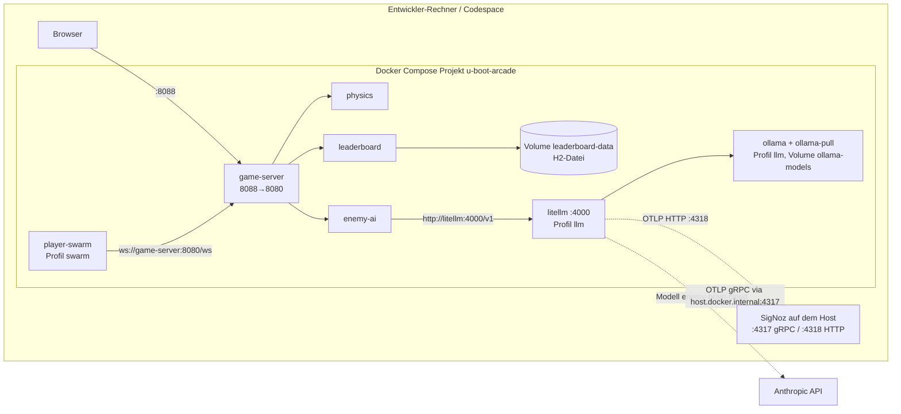

# Verteilungssicht — Docker Compose (umgesetzt)

<!-- ABGELEITET: Aus docker-compose.yaml, Dockerfile, .env.example, deploy/litellm-config.yaml, bitte verifizieren -->

## Übersichtsdiagramm

## Profile

| Aufruf | Gestartete Container |
|--------|---------------------|
| `docker compose up --build` | game-server, physics, leaderboard, enemy-ai (3 Bots, 2 regelbasierte Gegner) |
| `--profile swarm` | zusätzlich player-swarm (`SWARM_PLAYERS`, Standard 10) |
| `--profile llm` | zusätzlich litellm, ollama, ollama-pull (`qwen2.5:3b`) |

## Besonderheiten

- Gemeinsame Einstellungen über YAML-Anker: `restart: unless-stopped`, Memory-Limit 768 MB je Java-Service,
  `host.docker.internal` → Host-Gateway.
- OTLP-Ziel `OTEL_EXPORTER_OTLP_ENDPOINT` (Standard `http://host.docker.internal:4317`, gRPC),
  `OTEL_METRIC_EXPORT_INTERVAL` 10 s, Resource `service.namespace=u-boot-arcade`, `deployment.environment.name=${DEPLOY_ENV:-local}`.
- `leaderboard` schreibt seine H2-Datei nach `/data` (`DB_URL=jdbc:h2:file:/data/leaderboard`) auf das Volume
  `leaderboard-data`; das Image legt `/data` für den Benutzer 10001 an.
- LiteLLM exportiert eigene Spans per OTLP/HTTP (`LITELLM_OTEL_ENDPOINT`, Standard `:4318`); Modellwahl über Alias
  `enemy-brain` (Ollama) bzw. `enemy-brain-cloud` (Anthropic `claude-haiku-4-5`, `ANTHROPIC_API_KEY`).
- Images `litellm:main-stable` und `ollama:latest` sind nicht versioniert gepinnt. <!-- TODO: Bitte ergänzen – bewusst? -->
