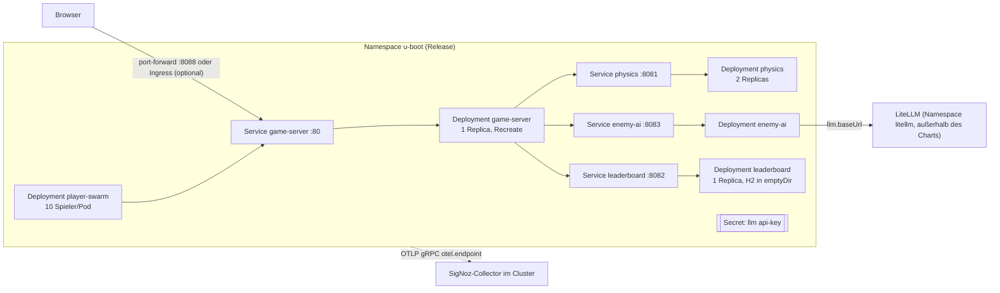

# Verteilungssicht — Kubernetes mit Helm (umgesetzt, ungetestet)

<!-- ABGELEITET: Aus deploy/helm/u-boot-arcade (values.yaml, templates/*), deploy/build-images.sh, bitte verifizieren -->

> Das Chart wurde nur mit einem eigenen Renderer geprüft, nicht mit `helm lint` und nicht in einem Cluster.

## Übersichtsdiagramm

## Besonderheiten

- **Installation:** `deploy/build-images.sh <registry> <tag>` baut und pusht 5 Images, dann `helm upgrade --install … --set image.registry=… --set otel.endpoint=…`.
- **Skalierung:** `physics.replicas` (Standard 2), `playerSwarm.replicas`; `gameServer.replicas` muss 1 bleiben, Update-Strategie `Recreate` verhindert zwei Spielstände gleichzeitig.
- **Ressourcen:** Requests/Limits je Komponente in `values.yaml` (z. B. game-server 250m/384Mi, Limit 768Mi).
- **Probes:** Readiness/Liveness über `/actuator/health`.
- **Telemetrie:** gemeinsame Env-Variablen aus `_helpers.tpl`; Resource-Attribute inkl. `k8s.pod.name`, `k8s.namespace.name`, `k8s.node.name`, `deployment.environment.name=workshop`; `extraResourceAttributes` z. B. für Teams.
- **Ingress:** optional; Annotationen für ingress-nginx setzen WebSocket-Timeouts auf 3600 s.
- **Leaderboard-Daten:** H2-Datei in einem `emptyDir` an `/data`, bewusst flüchtig. `leaderboard.replicas` muss 1 bleiben,
  da jede Replica ihre eigene Datei hätte.
- **LiteLLM/Modell** sind nicht Teil des Charts: Das Workshop-Cluster stellt LiteLLM als `litellm-service.litellm:4000` (ADR-15).
- Ob das Cluster-Szenario im Workshop überhaupt genutzt wird, ist offen. <!-- TODO: Bitte ergänzen -->
