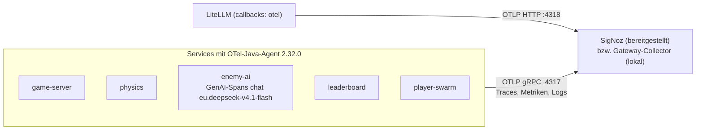
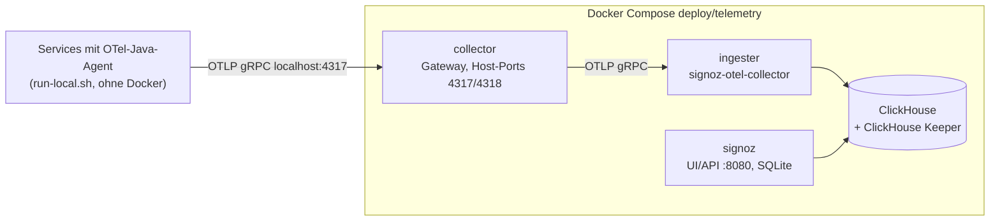
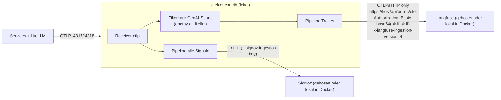

# Verteilungssicht — Telemetrie-Fluss

<!-- ABGELEITET: Aus run-local.sh, .env.example, Helm-Helpers, Dockerfile, LlmClient.kt, README.md und offenen Aufgaben, bitte verifizieren -->

## Heute (umgesetzt)

Alle Services exportieren über den OTel-Java-Agent an **ein** OTLP-Ziel (`OTEL_EXPORTER_OTLP_ENDPOINT`,
in `.env.example` und Helm gRPC). LiteLLM exportiert separat per OTLP/HTTP. Langfuse ist **nicht** angebunden.
Je Telemetrie-Betriebsart ist das Ziel das gehostete SigNoz (*bereitgestellt*) oder der Collector aus dem
Telemetrie-Compose (*lokal*, siehe unten).
In der Telemetrie-Betriebsart „ohne Telemetrie“ (Standard in `.env.example`, `OTEL_*_EXPORTER=none`) gibt es keinen Export; die
Services laufen trotzdem instrumentiert (ADR-10).

## Lokal: Telemetrie-Compose (umgesetzt, #5)

`deploy/telemetry/docker-compose.yaml` startet die Telemetrie-Services getrennt von der Anwendung (ADR-10, ADR-11).
Einziger Eingang am Host ist ein eigener Gateway-Collector (`otel/opentelemetry-collector-contrib`); er leitet alle
Signale an den Collector von SigNoz („ingester“) weiter, der in ClickHouse schreibt. Die SigNoz-Dateien sind mit
Foundry aus `deploy/telemetry/signoz/casting.yaml` erzeugt (Metadaten in SQLite); Begründung in ADR-13.

| Service | Image | Host-Port (nur `127.0.0.1`) | Version festgelegt in |
|---|---|---|---|
| `collector` | `otel/opentelemetry-collector-contrib:0.163.1` | 4317, 4318 | `docker-compose.yaml` |
| `ingester` | `signoz/signoz-otel-collector:v0.144.14` | – | `casting.yaml` |
| `signoz-signoz-0` | `signoz/signoz:v0.146.0` | 8080 | `casting.yaml` |
| `signoz-telemetrystore-clickhouse-0-0` | `clickhouse/clickhouse-server:25.12.5` | – | Foundry v0.3.0 |
| `signoz-telemetrykeeper-clickhousekeeper-0` | `clickhouse/clickhouse-keeper:25.12.5` | – | Foundry v0.3.0 |
| Init: `…-user-scripts`, `…-migrator` | wie oben | – (laufen beim Start und beenden sich; `user-scripts` lädt von GitHub) | – |

- **Admin-Konto beim Start:** SigNoz legt per `SIGNOZ_USER_ROOT_*` ein festes Konto samt Organisation an. Ohne
  Organisation gibt SigNoz seinem Collector per OpAMP nur eine leere Konfiguration, und der nimmt keine Daten an.
- **Ausfall:** Fehlt der Gateway-Collector, verwerfen die Agents die Daten und loggen Fehler; danach exportieren sie ohne
  Neustart weiter (geprüft). Startet SigNoz noch, puffert der Gateway-Collector kurz (Standard-Queue und -Retry des OTLP-Exporters, bis 5 min).
- **Speicher:** rund 1 GB RAM mit laufendem Spiel, davon gut die Hälfte ClickHouse.

## Geplant: Collector als Fan-out (#11)

Der Gateway-Collector bekommt eine zweite Pipeline: alle Signale weiter an SigNoz, nur GenAI-Spans (`enemy-ai`,
`litellm`) an Langfuse (Ausgestaltung in #11). Ohne Docker (Workshop) bleibt dafür nur ein
`otelcol-contrib`-Binary.

## Besonderheiten

- **Langfuse nur per HTTP** (kein gRPC); Zugang über Public/Secret Key als Basic-Auth.
- **Langfuse-Attribute fehlen noch:** `LlmClient` setzt heute keine Prompt/Completion-Inhalte, keine `langfuse.session.id`
  und kein `gen_ai.usage.cost` (Kosten nur als `enemy_ai.llm.cost_usd` bzw. Metrik `enemy_ai.llm.cost`) – geplant.
- **Volumen:** 20 Ticks/s = 20 Traces/s. Für gehostetes SigNoz Sampling `parentbased_traceidratio` (z. B. 0,1) empfohlen;
  Standard ist `parentbased_always_on`. Metrik-Exportintervall 10 s (`.env.example`/Helm).
- **Zielwahl nur per Umgebung:** `OTEL_*_EXPORTER`, `OTEL_EXPORTER_OTLP_ENDPOINT`, `OTEL_EXPORTER_OTLP_HEADERS`, Sampler-Variablen;
  weder Code noch Startskripte kennen Adressen. Telemetrie-Betriebsarten siehe [08-02](../08-Konzepte/08-02-Telemetrie.md).
- Filterkriterium für GenAI-Spans (Service-Name oder `gen_ai.*`-Attribute) und Collector-Konfiguration. <!-- TODO: Bitte ergänzen -->
