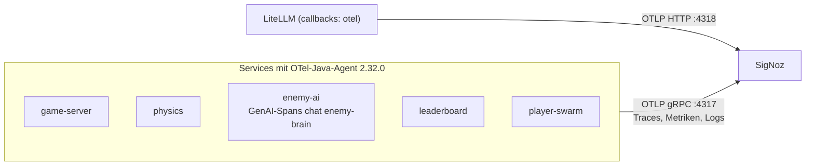
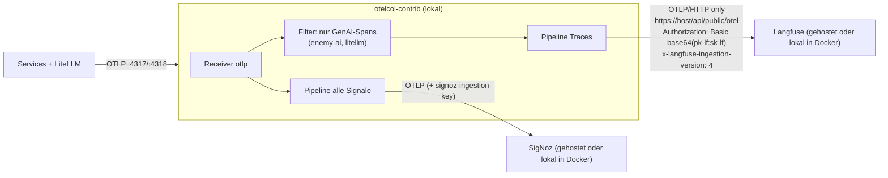

# Verteilungssicht — Telemetrie-Fluss

<!-- ABGELEITET: Aus run-local.sh, .env.example, Helm-Helpers, Dockerfile, LlmClient.kt, README.md und offenen Aufgaben, bitte verifizieren -->

## Heute (umgesetzt)

Alle Services exportieren über den OTel-Java-Agent direkt an **ein** OTLP-Ziel (`OTEL_EXPORTER_OTLP_ENDPOINT`,
in `.env.example` und Helm gRPC). LiteLLM exportiert separat per OTLP/HTTP. Langfuse ist **nicht** angebunden.
In der Telemetrie-Betriebsart „ohne Telemetrie“ (Standard in `.env.example`, `OTEL_*_EXPORTER=none`) gibt es keinen Export; die
Services laufen trotzdem instrumentiert (ADR-10).

## Geplant: lokaler Collector als Fan-out

Ein lokaler OpenTelemetry Collector (`otelcol-contrib`-Binary, ohne Docker) nimmt alles an und verteilt:
alle Signale an SigNoz, nur GenAI-Spans (`enemy-ai`, `litellm`) an Langfuse.

## Besonderheiten

- **Langfuse nur per HTTP** (kein gRPC); Zugang über Public/Secret Key als Basic-Auth.
- **Langfuse-Attribute fehlen noch:** `LlmClient` setzt heute keine Prompt/Completion-Inhalte, keine `langfuse.session.id`
  und kein `gen_ai.usage.cost` (Kosten nur als `enemy_ai.llm.cost_usd` bzw. Metrik `enemy_ai.llm.cost`) – geplant.
- **Volumen:** 20 Ticks/s = 20 Traces/s. Für gehostetes SigNoz Sampling `parentbased_traceidratio` (z. B. 0,1) empfohlen;
  Standard ist `parentbased_always_on`. Metrik-Exportintervall 10 s (`.env.example`/Helm).
- **Zielwahl nur per Umgebung:** `OTEL_*_EXPORTER`, `OTEL_EXPORTER_OTLP_ENDPOINT`, `OTEL_EXPORTER_OTLP_HEADERS`, Sampler-Variablen;
  weder Code noch Startskripte kennen Adressen. Telemetrie-Betriebsarten siehe [08-02](../08-Konzepte/08-02-Telemetrie.md).
- Filterkriterium für GenAI-Spans (Service-Name oder `gen_ai.*`-Attribute) und Collector-Konfiguration. <!-- TODO: Bitte ergänzen -->
