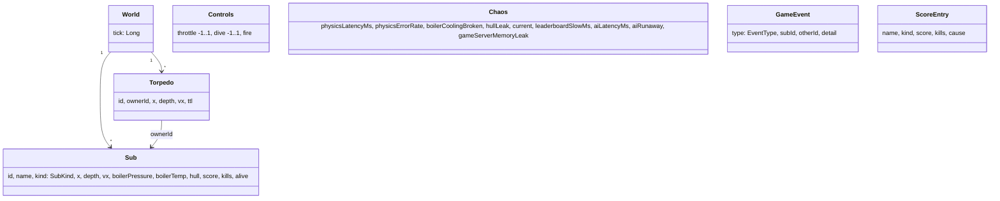

# Domänenmodell

<!-- ABGELEITET: Aus Code erkannt (game-core/src/main/kotlin/de/innoq/uboot/core/Model.kt), bitte verifizieren -->

## Übersicht

## Kernentitäten

| Entität | Beschreibung | Wichtige Attribute |
|---|---|---|
| `World` | Kompletter Spielstand eines Ticks | `tick`, `subs`, `torpedoes` |
| `Sub` | Ein U-Boot, gesteuert von Spieler, Bot oder Gegner-KI (`SubKind` PLAYER/BOT/ENEMY) | Tiefe (m), Dampfdruck (bar), Kesseltemperatur (°C), Rumpf (%), Punkte |
| `Controls` | Steuerbefehl für einen Tick | `throttle`, `dive`, `fire` |
| `Chaos` | Globale Störungsschalter (siehe [08-03](08-03-Chaos-und-Stoerungen.md)) | neun Schalter |
| `GameEvent` | Ereignis aus der Physik | `EventType`: TORPEDO_FIRED, HIT, KILL, DESTROYED, RESPAWN, OVERHEAT, VALVE_VENT, CRUSH_DEPTH, SURFACED |
| `ScoreEntry` | Ergebnis einer Runde (ein Leben) fürs Leaderboard | `score`, `kills`, `cause` |

## Regeln

- Alle Modellklassen sind **unveränderlich** (Kotlin `data class`); die Physik liefert pro Tick eine neue `World`.
- Die Modellklassen sind zugleich das **Austauschformat** zwischen den Services (`StepRequest/StepResponse`,
  `DecideRequest/DecideResponse`, `ScoreEntry` als JSON).
- `game-core` ist frameworkfrei (siehe [ADR-02](../09-Entscheidungen/09-02-game-core-frameworkfrei.md)).
