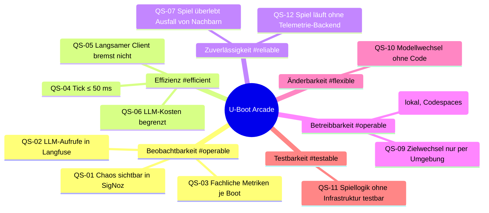

# Qualitätsbaum

> Die wichtigsten Qualitätsziele stehen in [Sektion 1.2](../01-Einfuehrung-und-Ziele/01-02-Qualitaetsziele.md).
> Hier die vollständige Übersicht mit Szenarien.

| Kategorie | Qualitätsanforderung | Priorität | Szenario | Status |
|---|---|---|---|---|
| #operable (Beobachtbarkeit) | Ausgelöste Störung ist in SigNoz zeitnah erkennbar | Hoch | QS-01 | umgesetzt (Zeitziel offen) |
| #operable (Beobachtbarkeit) | GenAI-Aufrufe in Langfuse nachvollziehbar | Hoch | QS-02 | geplant |
| #operable (Beobachtbarkeit) | Fachliche Werte pro Boot als Metrik | Mittel | QS-03 | umgesetzt |
| #efficient | Tick-Dauer innerhalb des Tick-Intervalls | Hoch | QS-04 | umgesetzt, nicht gemessen |
| #efficient | Langsame Clients beeinflussen Tick nicht | Mittel | QS-05 | umgesetzt |
| #efficient (Kosten) | LLM-Kosten pro Workshop begrenzt | Hoch | QS-06 | teilweise |
| #reliable | Ausfall von physics/enemy-ai/leaderboard beendet das Spiel nicht | Hoch | QS-07 | umgesetzt |
| #reliable | Spiel läuft ohne gestartetes Telemetrie-Backend | Hoch | QS-12 | umgesetzt (ADR-10) |
| #operable | Start ohne Docker lokal, in Codespaces und im Workshop-VS-Code | Hoch | QS-08 | umgesetzt, Codespaces/Workshop nicht erprobt |
| #operable | Telemetrie-Ziele ohne Codeänderung umstellbar | Hoch | QS-09 | umgesetzt |
| #flexible | LLM-Modell ohne Codeänderung wechseln | Mittel | QS-10 | umgesetzt |
| #testable | Spiellogik ohne Spring/Netz testbar | Mittel | QS-11 | umgesetzt |

<!-- TODO: Bitte ergänzen – Prioritäten mit Sektion 1.2 abgleichen -->
